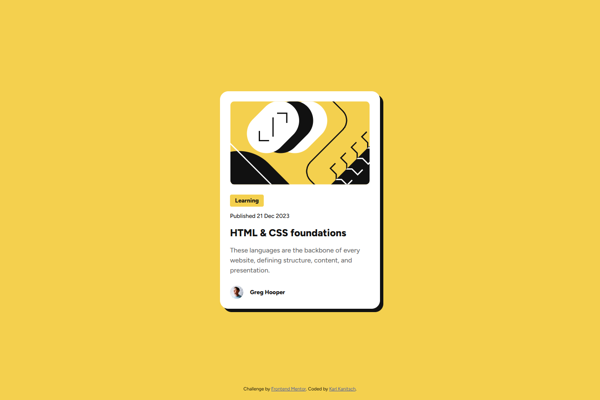
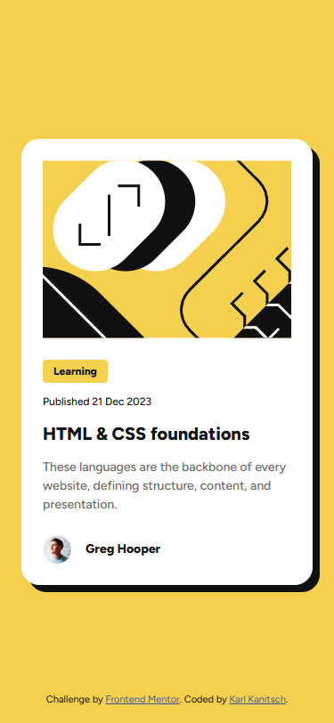
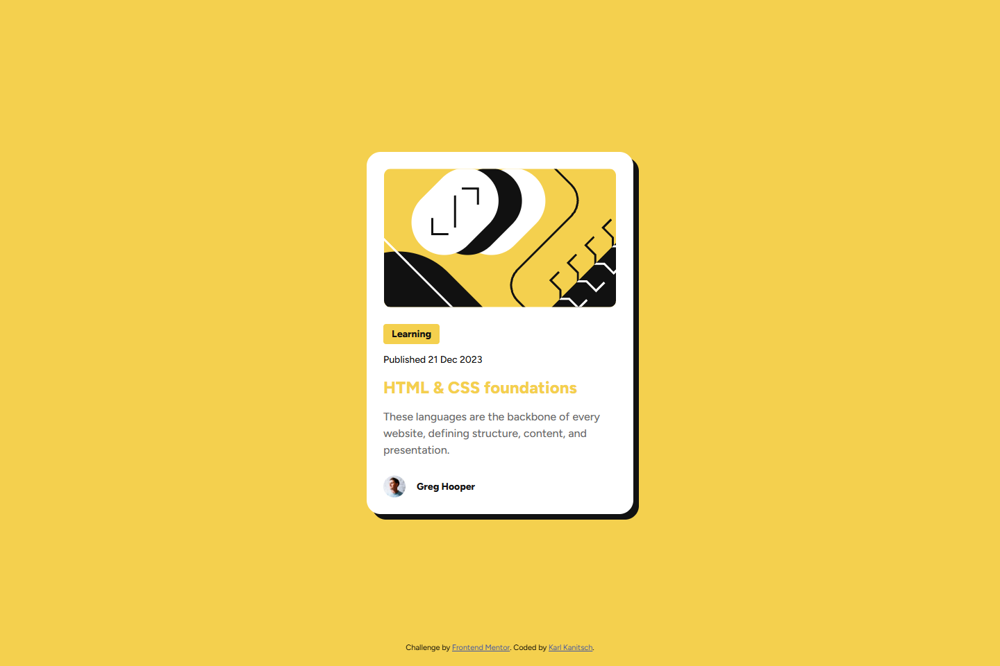

# Frontend Mentor - Blog preview card solution

This is a solution to the [Blog preview card challenge on Frontend Mentor](https://www.frontendmentor.io/challenges/blog-preview-card-ckPaj01IcS). Frontend Mentor challenges help you improve your coding skills by building realistic projects. 

## Table of contents

- [Frontend Mentor - Blog preview card solution](#frontend-mentor---blog-preview-card-solution)
	- [Table of contents](#table-of-contents)
	- [Overview](#overview)
		- [The challenge](#the-challenge)
		- [Screenshot](#screenshot)
		- [Links](#links)
	- [My process](#my-process)
		- [Built with](#built-with)
		- [What I learned](#what-i-learned)
		- [Useful resources](#useful-resources)
	- [Author](#author)

## Overview

This is a basic blog post summary card component built to have responsive font sizes without @media queries. It also includes a hover state for the blog entry title that behaves like a link with a color to match the components overall theme.

### The challenge

Users should be able to:

- See hover and focus states for all interactive elements on the page

### Screenshot

- Normal Desktop View 
- Mobile View  
  
- Desktop Hover View 

### Links

- Solution URL: [Github Repository](https://github.com/kkanit22/FEM-1-2-blog-preview-card)
- Live Site URL: [Live Site](https://kkanit22.github.io/FEM-1-2-blog-preview-card/)

## My process

### Built with

- Semantic HTML5 markup
- CSS custom properties
- Flexbox
- Mobile-first workflow

### What I learned

The main new thing that I saw from this challenge was the clamp() function in css which I used to scale the font size without media queries. I also took some time to remind myself of using variables in CSS without a post processor like SASS.

### Useful resources

- [MDN Docs - Clamp() CSS Function](https://developer.mozilla.org/en-US/docs/Web/CSS/Reference/Values/clamp) - I have never seen the clamp function before and this provided more detail than I needed for this project, but as I continue to implement this function I am sure to return and re-read many times.
- [MDN Docs - Using CSS custom properties (variables)](https://developer.mozilla.org/en-US/docs/Web/CSS/Guides/Cascading_variables/Using_custom_properties) - MDN offers great insights into web development topics ranging from simple examples to in-depth details and suggestions on how best to implement them.

## Author

- Frontend Mentor - [@kkanit22](https://www.frontendmentor.io/profile/kkanit22)
